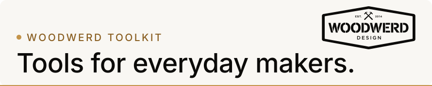
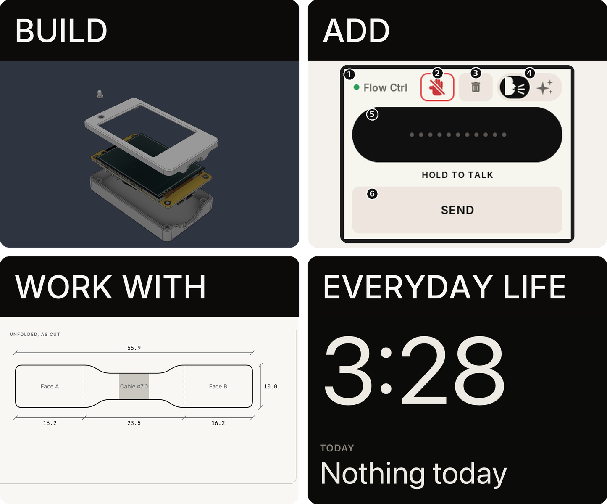

<picture>
  <source media="(prefers-color-scheme: dark)" srcset="assets/banner-dark.svg">
  <source media="(prefers-color-scheme: light)" srcset="assets/banner-light.svg">
  
</picture>

WOODWERD uses design to solve everyday problems. Most of what's here is about control: hardware you build, digital tools that give it a job, and software that puts your other tools to work. The rest is for everyday life, because a good tool can make a day better as well as more productive. Everything released here is open and free to use.

## Build an interface

Start here. A small touch-screen board in a printed case makes a control you can put on your desk. Buy the [Cheap Yellow Display](https://github.com/witnessmenow/ESP32-Cheap-Yellow-Display), build the case, then decide what it becomes.

| Tool | What it does | Status |
| --- | --- | --- |
| [Ctrl Case](https://github.com/WOODWERD/cyd-case) | A printed housing for the 2.8" board, shared by every display tool. [Build guide](https://woodwerd.github.io/cyd-case/) | Released |

## Add a digital tool

Software gives the board its job. Load different firmware and the same board becomes a different tool.

| Tool | What it does | Status |
| --- | --- | --- |
| [ESP Ctrl](https://github.com/WOODWERD/esp-ctrl) | Flash firmware and watch the serial log in your browser. [Open it](https://woodwerd.github.io/esp-ctrl/) | Stable |
| [Flow Ctrl](https://github.com/WOODWERD/cyd-flow-ctrl) | Dictation remote for Wispr Flow. [Flash it](https://woodwerd.github.io/cyd-flow-ctrl/flash/) | Beta |
| Media Ctrl | Media remote for the Mac and iPad | In progress |
| Claude Ctrl | Push-to-talk remote for Claude's voice input | In progress |

## Work with your other tools

Some jobs don't need a new screen, just more from a machine you already own. These tools need no board. So far that machine is a printer, making labels for the things around your bench.

| Tool | What it does | Status |
| --- | --- | --- |
| [Cable Ctrl](https://github.com/WOODWERD/cable-ctrl) | Fold-over cable flags for the Liene PixCut S1. [Open it](https://woodwerd.github.io/cable-ctrl/) | Public beta |
| Box Ctrl | Labels for toolboxes | In progress |
| [File Ctrl](https://github.com/WOODWERD/file-ctrl) | Drawer labels for file cabinets. [Open it](https://woodwerd.github.io/file-ctrl/) | Public beta |

## Tools for everyday life

Not everything here is about getting more done. These tools are made to live with, so the ordinary parts of a day go a little better. They need no board.

| Tool | What it does | Status |
| --- | --- | --- |
| CtrlClock | A calm nightstand clock for iPhone that knows what tomorrow holds | In progress |

## Detour by Design

Everyday problems, solved by design. Follow along on [the WOODWERD channel](https://www.youtube.com/@WOODWERD).

## For builders

Every released tool here is MIT licensed, so take what's useful.

- **Tried it on something new?** Reports from other boards, Windows and Linux help most. Open an issue on that tool's repo and say what you used.
- **[ctrl-docs-theme](https://github.com/WOODWERD/ctrl-docs-theme)** is the documentation theme behind these guides, for Material for MkDocs.
- **[ESP32-Cheap-Yellow-Display](https://github.com/witnessmenow/ESP32-Cheap-Yellow-Display)** is the community home of the board. Start there to write your own firmware.

---

THINK · DESIGN · STYLE

WOODWERD LLC, Austin, Texas. Residential design, device apps, open hardware. Same eye, different materials. Independent projects, not affiliated with or endorsed by Espressif, Wispr or Liene.
